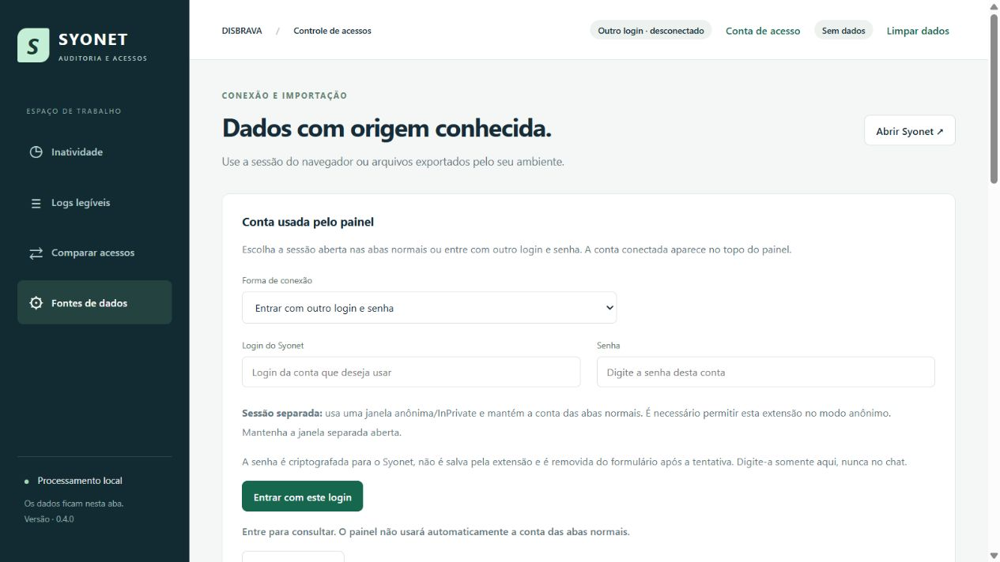

# SYONET — Auditoria e Acessos

Extensão independente para Chrome e Edge com rastreador de inatividade, leitura de logs, comparação e cópia de acessos e login alternativo em sessão separada.

**Versão:** 0.4.0 · Manifest V3 · JavaScript sem dependências de execução.

## Recursos

- Consulta todas as lojas autorizadas à conta conectada, inclui usuários ativos/inativos e deduplica por ID.
- Exibe nome completo, login, lojas, último acesso e avisos de consultas incompletas.
- Permite inativação individual pelo Syonet, com prévia, confirmação, validação de pendências e releitura.
- Importa logs estruturados em JSON, JSONL, CSV ou TSV e gera descrições legíveis localmente.
- Compara permissões, perfil e lojas de dois usuários; permite copiar permissões, perfil, lojas e equipes com prévia e relatório.
- Oferece outro login e senha em uma janela anônima/InPrivate, mantendo a conta das abas normais.

## Instalar

1. [Baixe o código em ZIP](https://github.com/ItalianoD/syonet-auditoria-acessos/archive/HEAD.zip) e extraia os arquivos.
2. Abra chrome://extensions ou edge://extensions e ative o Modo do desenvolvedor.
3. Clique em **Carregar sem compactação** e selecione a pasta que contém manifest.json.
4. Abra a extensão pelo ícone. Para usar a sessão normal, faça login no Syonet no mesmo navegador e recarregue essa aba com F5.

**Atualizar:** substitua os arquivos da pasta instalada, recarregue o cartão da extensão e reabra o painel. Confira a versão na lateral.

## Usar outro login sem trocar a conta normal

1. Nos detalhes da extensão, habilite **Permitir em modo anônimo** / **Permitir em InPrivate**.
2. No painel, abra **Conta de acesso → Entrar com outro login e senha**.
3. Preencha as credenciais somente no formulário e clique em **Entrar com este login**.
4. Mantenha a janela anônima do Syonet aberta e confira o login no topo do painel antes de consultar.

O painel valida a conta informada e não usa a sessão normal como alternativa silenciosa. A senha não é gravada pela extensão e é limpa do formulário após a tentativa. Outras abas anônimas do Syonet devem ser fechadas antes de autenticar outra conta privada, pois elas compartilham a sessão entre si.

## Guias

- [Manual completo](LEIA-ME.md)
- [Passo a passo do outro login](COMO-USAR-OUTRO-LOGIN.md)
- [Alterações da versão 0.4.0](ALTERACOES-0.4.0.md)
- [Arquivos fictícios de exemplo](exemplos)

## Desenvolvimento e testes

Não há instalação de pacotes nem etapa de compilação. Com Node.js 22 ou superior:

~~~sh
npm test
~~~

Ou execute os testes diretamente com node --test tests/*.test.js. São **58 testes locais** cobrindo leitura, cálculos, comparação/cópia, inativação, transporte, criptografia, identificação da conta e isolamento das abas. O arquivo tests/browser.html contém verificações dos leitores HTML para servir em um servidor HTTP local.

Os testes e exemplos usam dados fictícios. O novo login ainda precisa ser conferido com duas contas reais no Chrome/Edge com a extensão instalada. Fluxos exclusivos de SSO/MFA não são automatizados. Nenhuma conta real foi inativada ou teve seus acessos alterados durante o desenvolvimento.

## Ambiente e dados

A configuração atual aponta para disbrava.syonet.com. Para outro ambiente, ajuste config.js, manifest.json, rules.json, os validadores de domínio e o catálogo de equipes. Parte da integração depende das telas legadas e dos serviços do Syonet; mudanças no ambiente podem exigir adaptação.

O projeto não inclui credenciais, cookies, cadastros exportados, logs reais ou cópias de acessos do ambiente. Os dados consultados ficam na aba do painel; somente arquivos exportados pelo usuário permanecem no computador. O cadastro, as lojas e as permissões disponíveis dependem da conta autorizada no Syonet.

Este é um projeto independente e não representa uma extensão oficial do fornecedor do Syonet.
